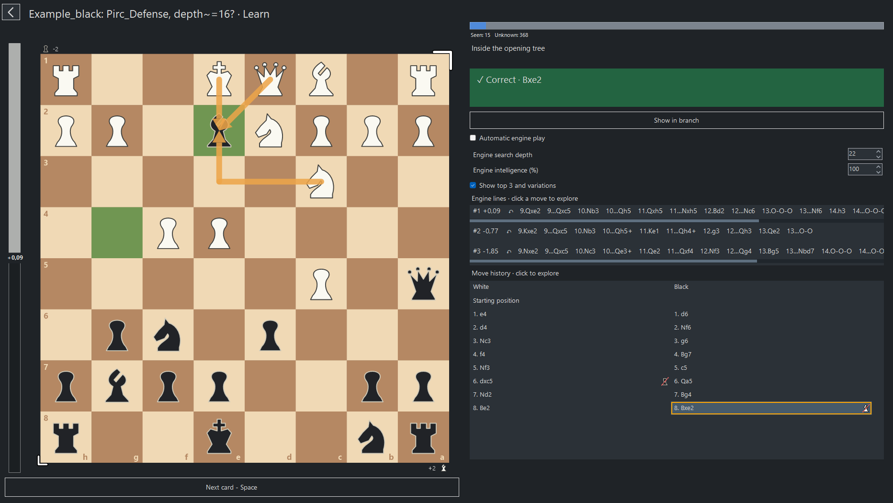
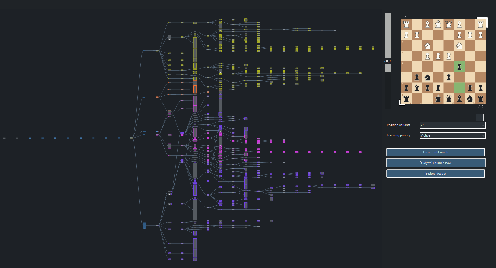
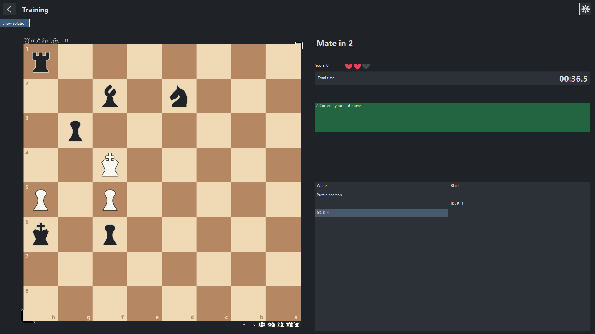
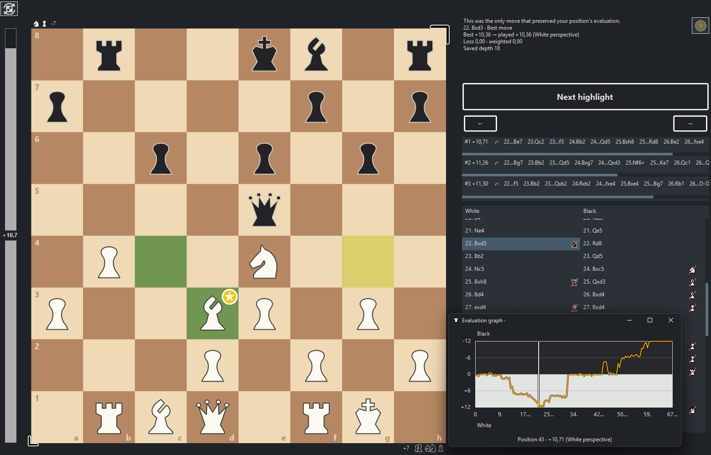
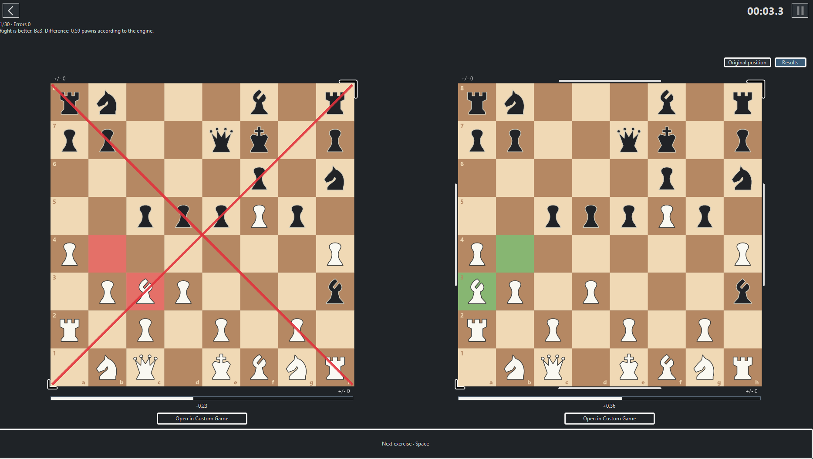
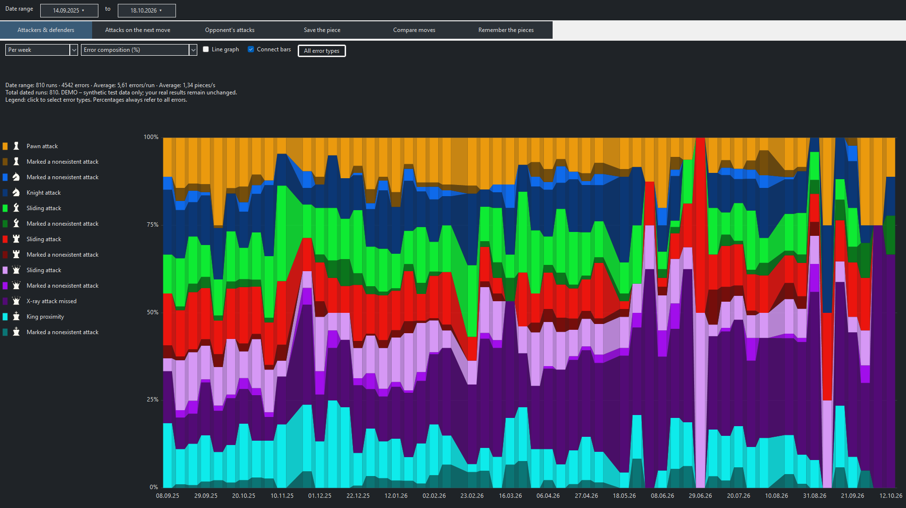

# Chess Opening Trainer

An open-source, local-first chess training application featuring built-in engine evaluation, advanced engine-assisted (Stockfish) opening-branch creation, interactive learning (learning tree visualized as branch-graph), automated puzzle generation, game analysis, and custom training modes.

**Information:** This application was developed with the help of codex. More information about the used prompts and the methodology can be found in [docs/ai-development](docs/ai-development/README.md). Figma was used to create some icons and Audacity to edit the credited sound effects.

**Current stable version:** version 0.26.5.

Windows release assets are available on the [0.26.5 Releases page](https://github.com/AdrianSomething/chess-trainer/releases/tag/v0.26.5). [0.25.3 remains available as a fallback](https://github.com/AdrianSomething/chess-trainer/releases/tag/v0.25.3).

[Download 0.26.5 for Windows](https://github.com/AdrianSomething/chess-trainer/releases/download/v0.26.5/ChessOpeningTrainer-0.26.5-win-x64.zip) · [Windows guide](docs/INSTALLATION.md) · [Developer guide](docs/DEVELOPMENT.md) · [Architecture](docs/ARCHITECTURE.md)

## Explore

### Opening learning:

*Learn-Mode: Every position is presented as one index card. One needs to choose the correct next move according to the opening.*

*Branch-Mode: Every opening can be visualized as a new opening as a branch system. Move sequences can be easier understood, edited and analysed.*

- Use **Branch-Mode** to view and edit the moving-branches of the opening you want to learn.
- Use **Learn-Mode** to learn your opening like index cards.
- Use **Freeplay-Mode** to practice the move sequences in order in a game against an engine.
- Use **Opening Branch Generator** to customize and create your own branches in a queue system with the help of an engine (or just add an opening json file directly into the Opening folder).
- Use **Database-Mode** to download played games from Lichess and analyse how relevant your repertoire is in a real environment.

### Puzzle Mode:

*Tactics Puzzle Mode: Kind of puzzle and win/lose conditions adjustable.*

- Solve engine generated puzzles (Mate in N, Material gain, ...).
- Practise endgame positions (e.g. King+Bishop+Horse vs King).
- Learn from your mistakes by uploading your games and correcting your previous blunders.
- Punish the potential mistakes from your opponent if they deviate from your learned opening.

### Analysis:

*Analysis: Move evaluation and match progress is directly shown.*

- Upload/Write your previous games as PGN files and view them.
- Analyse your games via build in engine evaluation.
- Play local games and save them directly for future analysis.

### Chess vision Mode:

*Compare moves Mode: Choose the better move to play.*

*Statistics: Here, shows the median error distribution by error type.*

- Play custom chess modes in which you need to mark all attacking pieces (**Attackers & defenders**), choose the better move (**Compare moves**), remember the position of pieces (**Remember pieces**), ... .
- View statistics according of your performance.

## Download and start

1. Open [Release 0.26.5](https://github.com/AdrianSomething/chess-trainer/releases/tag/v0.26.5).
2. Download [**ChessOpeningTrainer-0.26.5-win-x64.zip**](https://github.com/AdrianSomething/chess-trainer/releases/download/v0.26.5/ChessOpeningTrainer-0.26.5-win-x64.zip), not GitHub's automatic “Source code” archive.
3. Right-click the ZIP and choose **Extract All**.
4. Run **ChessOpeningTrainer.exe** from the extracted folder. Keep its supporting folders alongside it.

It is not code-signed; Windows may warn about an unfamiliar publisher. See [installation and updates](docs/INSTALLATION.md).

## For developers

The application is a modular WinForms project using .NET 10, WPF media playback and a local UCI engine. Existing feature boundaries are preserved.

On Windows with the .NET 10 SDK and PowerShell 7:

    pwsh -File tools/Get-Stockfish.ps1
    dotnet run --project src/ChessOpeningTrainer -p:PublicRelease=true

See [development](docs/DEVELOPMENT.md), [architecture](docs/ARCHITECTURE.md), [contribution guidelines](CONTRIBUTING.md), [packaging](docs/DISTRIBUTION.md) and [local validation](docs/RELEASE_VALIDATION.md). The public export intentionally does not yet include the private regression harness or a GitHub Actions workflow; [CI assessment](docs/CI_ASSESSMENT.md) records the proposed approach.

## Licensing and provenance

Project code and original code-generated assets are **GPL-3.0-or-later**; the maintainer-created raster icon sheet is **CC BY 4.0**. See [LICENSE](LICENSE) and [copyright scope](COPYRIGHT.md). Stockfish 19 is a separate, unmodified GPL-3.0-or-later executable. Release assets include its license and a corresponding-source companion with the exact neural network used by this build.

The complete Windows edition also contains edited Pixabay sound effects under the **Pixabay Content License**, not GPL. The source export uses project-synthesized sounds instead and does not redistribute these effects as a standalone sound collection. The Windows edition is therefore not an entirely freely relicensable asset collection. [Third-party notices](THIRD_PARTY_NOTICES.md) and [compliance evidence](docs/LICENSE_COMPLIANCE.md) explain the boundary.

## Contributing, security and citation

Read [CONTRIBUTING](CONTRIBUTING.md) and [SECURITY](SECURITY.md). Citation metadata is in [CITATION.cff](CITATION.cff). This community project comes without warranty.
